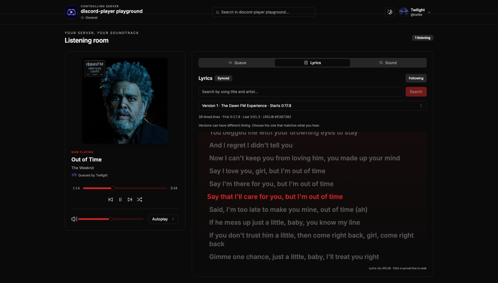

# Music Bot

A self-hosted Discord music bot with a browser dashboard. Slash commands and the dashboard control the same per-server Discord Player v8 queue. MongoDB keeps your volume, repeat mode, equalizer, effects and saved playlists. Redis holds expiring dashboard sessions.

Features include search and autocomplete, saved private or public playlists, previous/next track, pause/resume, repeat, shuffle, a 15-band equalizer, bass and vocal boost, 8D audio and optional crossfade. Playback uses Remedia, either embedded in the bot or on a separate server. A separate Bun source host provides YouTube, Spotify, Apple Music and SoundCloud discovery and streams. The dashboard remains a Next.js Pages Router application.



The screenshot shows the earlier layout. The current dashboard adds queue management, synced lyrics and a Sound tab; see [dashboard controls](docs/dashboard.md).

**Migration status:** this branch uses a development release of Discord Player. Local builds, tests and native playback checks are described in [validation](docs/validation.md). Live Discord/provider playback and the complete Compose stack have not been certified. The remote profile builds the official Remedia Dockerfile at a pinned source revision, using published 0.2.1 binaries. Embedded Docker provisions FFmpeg independently. Neither path compiles Remedia or FFmpeg.

## Before you start

- A Discord server where you can install applications.
- A Discord bot token. Open the [Developer Portal](https://discord.com/developers/applications), select **New Application**, give it a name, then open **Bot → Reset Token** and copy the token. Keep it private.
- Under **Installation**, enable Guild Install, select `bot` and `applications.commands` scopes, and grant **View Channels, Send Messages, Embed Links, Connect, Speak**. Open the generated install link and choose your server. No privileged Gateway intents are required.
- For Docker: Docker Engine/Desktop with **Compose 2.20 or later**, and internet access during the first build. Images target Linux x64 and ARM64.
- For manual hosting: **Node.js 24**, **pnpm 12.18.0**, **Bun 1.4.4**, MongoDB 8 and Redis 8 (or compatible external servers). Embedded playback also needs FFmpeg 9 shared libraries. See [manual installation](docs/manual-hosting.md).

The machine needs outbound HTTPS, Discord Gateway WebSockets and UDP voice access. MongoDB and Redis should be private services.

## Docker: embedded playback

```sh
git clone https://github.com/twlite/music-bot.git
cd music-bot
cp .env.example .env
```

Edit `.env` to set `DISCORD_TOKEN` from the Developer Portal and separate random values for `REMEDIA_PASSWORD` and `STREAM_PROVIDERS_TOKEN` (run `openssl rand -hex 32` twice). The Remedia password is required by Compose even when the remote profile is disabled. The provider token authenticates bot and Remedia requests to the source host; Compose supplies the same value to all three services. `NEXT_PUBLIC_BACKEND_URL` is the browser-visible API URL used when building the dashboard; its local default is `http://localhost:5000`.

Non-sensitive bot settings live in **`app.config.json`**. Docker mounts [docker/app.config.json](docker/app.config.json); manual hosting uses [apps/music-bot/app.config.json](apps/music-bot/app.config.json). Edit the matching file to change the dashboard origin (`http.dashboardUrl`), API port (`http.port`), Redis address, playback mode, crossfade and allowed media hosts. `crossfade.enabled` defaults to `false`; set it to `true` to enable overlap for new voice sessions. `crossfade.durationMs` accepts 1000–30000 milliseconds.

```sh
docker compose up -d --build
docker compose logs -f bot
```

The bot/API listens on host port 5000; the dashboard listens on 3000. Both ports bind to loopback. MongoDB, Redis, the source host and Remedia have no public port mappings. Persistent data goes into named Docker volumes. The bot installs prebuilt FFmpeg 9 libraries during its image build; you do not compile FFmpeg or Remedia.

For access from another computer, put an HTTPS reverse proxy in front of these loopback ports. Set `http.dashboardUrl` in `docker/app.config.json` to `https://music.example.com` and `NEXT_PUBLIC_BACKEND_URL=https://api.example.com`, then rebuild. Forward WebSocket upgrades to port 5000. Use dashboard/API names on the same site so browser session cookies work. See [operations](docs/operations.md).

## Play your first song

Join a voice channel and run `/play query:Daft Punk One More Time`, or paste a YouTube, Spotify, Apple Music or SoundCloud track URL. The included source host supplies these providers. Spotify and Apple Music catalog tracks use the extractors' matching-stream bridge rather than streaming protected catalog audio. Provider availability depends on the service and your network. You can also upload audio to Discord and use its HTTPS attachment URL; other direct audio hosts must be listed in `mediaAllowedHosts` in `app.config.json`.

Use `/join` to connect and prepare an empty queue before opening `/web`. You can then add songs from the dashboard, reorder or remove upcoming tracks, scrub the timeline, combine audio effects and follow synced lyrics. See [dashboard controls](docs/dashboard.md).

Use `/lyrics` for the playing track's lyrics in Discord, or `/lyrics query:<song title and artist>` to search.

Use `/pause`, `/resume`, `/skip`, `/back`, `/seek`, `/shuffle`, `/volume`, `/loop`, `/stop` and `/leave`. `/playlist create` saves the current and upcoming tracks; `/playlist list` shows your IDs. Play one with `/play query:playlist:<id>`.

Run `/web` while in the bot's voice channel. Open the private link within **60 seconds**. The dashboard exchanges it once for an HTTP-only, one-hour cookie, then removes the code from the address bar. Do not share the link. Reloading uses the cookie; an expired session requires a new `/web` link. Every action rechecks your Discord membership and voice access.

## Remote playback

The optional profile starts `ghcr.io/twlite/remedia:0.2.1`, using the password from `.env`:

```sh
docker compose --profile remote up -d --build
```

Compose starts Remedia before the bot. The bot detects the profile's Remedia service through internal DNS and selects remote playback. With no remote service it selects embedded playback. Commands, playlists and dashboard behavior use the same player in both modes. The Docker config uses `remedia.mode: "compose"` to select the running profile automatically. When changing modes on an already running stack, stop it first so the bot rechecks the selected profile. Volumes are retained. Then run either startup command; for example, to return to embedded mode:

```sh
docker compose --profile remote down
docker compose up -d --build --force-recreate
```

Do not add `--volumes` to `down`. The pinned registry tag was unavailable during validation, so `--build` builds the official image from its pinned upstream Dockerfile. The first build downloads published binaries and FFmpeg libraries. See [manual remote setup and source hosts](docs/manual-hosting.md).

## Hosting without Docker

```sh
npm install --global pnpm@12.18.0 bun@1.4.4
pnpm install --frozen-lockfile
cp apps/music-bot/.env.example apps/music-bot/.env
cp apps/stream-providers/.env.example apps/stream-providers/.env
cp apps/web/.env.example apps/web/.env.local
```

Set the Discord token and passwords in `apps/music-bot/.env`. Generate a provider token with `openssl rand -hex 32` and put the same `STREAM_PROVIDERS_TOKEN` in that file and `apps/stream-providers/.env`. Edit database/Redis addresses and other non-sensitive settings in `apps/music-bot/app.config.json`. Install FFmpeg 9 for embedded mode using the [platform instructions](docs/manual-hosting.md). Then:

```sh
pnpm build
# Terminal/service 1: Bun runs the TypeScript source directly
pnpm --filter stream-providers start
# Terminal/service 2 (after the source host is listening)
pnpm --filter music-bot start
# Terminal/service 3
pnpm --filter web start
```

For development, use `pnpm --filter stream-providers dev`, `pnpm --filter music-bot dev` and `pnpm --filter web dev` in separate terminals. CommandKit watches and reloads the bot during development. Dashboard development supports hot reload. Production should use the `start` commands and a process supervisor; the source host has no build step. See [source-host configuration](docs/stream-providers.md) for addresses, authentication and remote Remedia setup. [Manual hosting](docs/manual-hosting.md) covers Windows, macOS, Linux, external services, environment variables and systemd.

## Updating and backups

Back up MongoDB before updating. MongoDB volumes contain guild settings and playlists; Redis sessions can expire without losing playlists. Stop the bot, pull the new revision, rebuild and restart. Saved v6 playlists are read without rewriting their records; each URL is resolved using the current providers. Missing or unsafe tracks fail clearly and leave the original playlist intact.

See [backup, restore, upgrades and rollback](docs/operations.md), [saved playlist migration](docs/playlists.md), and [troubleshooting](docs/troubleshooting.md).

## Development checks

```sh
pnpm format:check
pnpm test
pnpm typecheck
pnpm lint
pnpm build
pnpm --filter music-bot exec node scripts/native-smoke.mjs
```

`pnpm format` applies the shared oxfmt configuration. `pnpm test` runs bot and dashboard tests.

The last command requires FFmpeg 9 and checks local native decoding with a null output, filters, crossfade preparation and controls. It does not connect to Discord. Provider limitations and the remaining live validation checklist are recorded in [validation](docs/validation.md).
